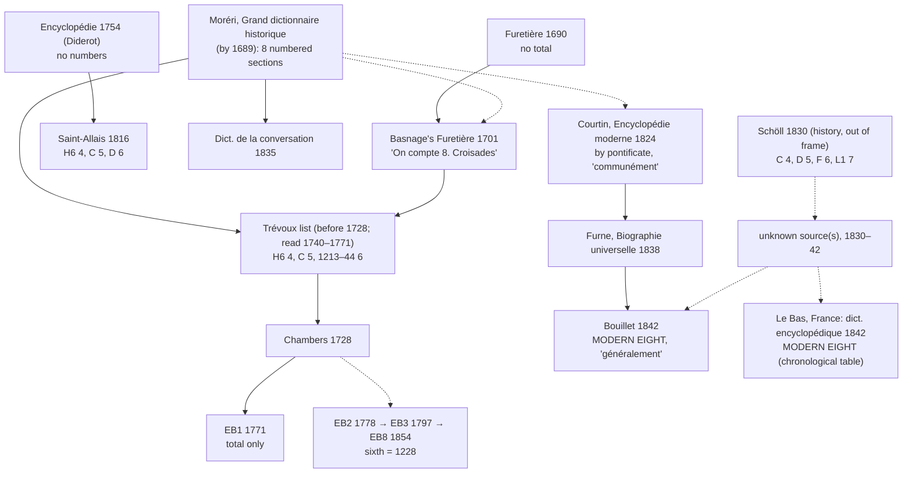

# Strand A: the stemma of the "Croisade(s)" entry, French and English, 1690–1869

10 November 2026. Step 2 of `docs/SEARCH_PROTOCOL.md`. Data: `data/strand_a/entries.csv` (34 entries), `data/strand_a/not_reached.csv` (14 works or editions in the frame not yet read), `data/search_log.csv` (25 searches). Built by `scripts/build_strand_a.py`.

## 1. Result

Claim, in the protocol's template, restricted to reference works:

> The modern eight is attested complete in reference works by 1842, in two Paris books of that year: Bouillet's *Dictionnaire universel d'histoire et de géographie* (Hachette) and vol. 6 of Le Bas's *France: dictionnaire encyclopédique* (Didot). In the 24 French and English reference entries of 1689–1838 read so far (17 French, 7 English, covering 13 distinct works), none has it. The nearest predecessors are Courtin's *Encyclopédie moderne* (1824) and Furne's *Biographie universelle* (1838), which differ in the fourth, fifth and sixth slots. In reference works the change falls between 1838 and 1842.

That bracket is for dictionaries only. Outside them, Schöll's *Cours d'histoire des états européens* (Paris and Berlin, 1830) already numbers 1202–04 fourth (t. 6, p. 102), 1217 fifth, 1228 sixth and 1248 seventh (t. 4, §§ VII–VIII), with Louis IX's second crusade named but not numbered. So the swap is at least twelve years older than Bouillet, and it was made outside the dictionaries. The reference books reported it.

## 2. One family, for 150 years

Every French and English reference entry from 1689 to 1838 that numbers all eight uses a single scheme, which goes back to Moréri. Call it the **Moréri eight**:

| Slot | Moréri eight | Modern eight |
|---|---|---|
| 4 | Henry VI, 1195 (Celestine III) | 1202–04 |
| 5 | 1198, Innocent III, Fulk of Neuilly (= 1202–04) | Damietta, 1217–21 |
| 6 | 1213 to 1244: Damietta, Frederick II and the Barons' Crusade as one | Frederick II, 1228–29 |
| 7 | Louis IX, 1245/48 | Louis IX, 1248–54 |
| 8 | Louis IX, 1268/70 ("et dernière") | Tunis, 1270 |

The witnesses:

- **Moréri, *Grand dictionnaire historique*.** By 1689 the CROISADE article has eight numbered sections, "Première Croisade" to "Huitième & dernière Croisade". The 1702 and 1732 editions show the middle: fourth 1195 (Celestine III and Henry VI), fifth 1198 (Innocent III), sixth from 1213, seventh 1245 (Council of Lyon), eighth 1255–70.
- **Furetière.** The 1690 first edition gives the first crusade and no total. Basnage's 1701 revision adds "On compte 8. Croisades." (1708 and 1727: "On compte huit Croisades"). This is the first dictionary sentence stating the total, and the formula survives for 140 years.
- **Trévoux** (1740, 1743, 1752, 1771) puts Moréri's sections into one sentence each, under Furetière's formula: "On compte huit Croisades pour la conquête de la Terre Sainte. La première ... en 1095 ... La quatrième en 1195 par le Pape Célestin III. & l'Empereur Henri VI. La cinquième fut publiée en 1198 ... La sixième ... commença tumultuairement en 1213, & finit en 1244." The years are Moréri's section years.
- **Chambers (1728)** translates that sentence ("They reckon eight Croisades ... the sixth ... began tumultuarily, in 1213"). So the Trévoux list existed before 1728, although the 1704, 1721 and 1732 editions could not be read (image-only scans). **EB1 (1771)** keeps Chambers's first clause and drops the list.
- **Britannica, 2nd, 3rd and 8th editions (1778, 1797, 1854; the 4th to 7th not read).** A new, long article keeps the Moréri eight but dates the sixth to 1228 and folds Damietta, Frederick II, Richard of Cornwall and Gaza into it. The text is the same in all three. Britannica, at least, did not have the modern eight before EB11 (1911); EB9 (1877) had Cox's nine (corpus row, from the paper's table).
- **Saint-Allais (1816)** pairs the *Encyclopédie*'s text with a dated list: fourth 1195, fifth 1199, sixth 1217. Frederick II has no number.
- **Courtin, *Encyclopédie moderne*, t. 7 (1824)** reorganizes the Moréri eight by pontificate: "On compte communément huit croisades." IV Célestin III, V Innocent III (1198–1204), VI Honorius III and Grégoire IX (1220–1240), VII Innocent IV, VIII Clément IV.
- **Furne, *Biographie universelle* (1838)** abridges Courtin, wording included.
- ***Dictionnaire de la conversation*, t. 18 (1835)** uses Moréri's headings and dates (fifth 1198–1204, sixth 1213–1240, eighth 1255–1291).

The one *Encyclopédie* entry (Diderot, t. 4, 1754) numbers nothing. It names expeditions by leader and says it was taken from Voltaire and Fleury.

## 3. What Bouillet did

Bouillet's entry is an abridgment of the Courtin text, probably through Furne:

| Courtin 1824 / Furne 1838 | Bouillet 1842 |
|---|---|
| "les différentes expéditions qui, depuis 1097 jusqu'en 1291, furent armées sous les auspices du saint-siége" | "plusieurs expéditions qui, depuis 1096 jusqu'en 1291, furent entreprises, sous les auspices du saint-siège" |
| Furne: "on désigne plus spécialement" | "On donne spécialement ce nom" |
| "On compte communément huit croisades" | "On compte généralement huit croisades" |
| Eight sections, each headed by a pontificate | Eight paragraphs, each dated "sous le pontificat de" |

He made two changes, and they are the whole difference between the two schemes. He dropped Courtin's fourth (Celestine III, Henry VI), and he split Courtin's sixth (Honorius III and Gregory IX) into a fifth under Honorius III (1218, Damietta) and a sixth under Gregory IX (1228–29, Frederick II). The total stayed at eight, which is why nobody noticed a change. His further reading is Michaud and Mills (in Tiby's 1825 French translation), and neither has his slots.

Two consequences for the argument:

1. **"Généralement" is not testimony that the modern slots were customary.** It is Courtin's "communément" of 1824, and Courtin was describing the Moréri eight. The formula goes back to Basnage's "On compte 8. Croisades" (1701). What was customary was the total. Section 5.4 of the protocol should be amended: a statement of custom dates the custom of a *count*, and only the slot assignments date the scheme.
2. **Bouillet reported the swap; he did not make it.** Le Bas's Didot volume of the same year has the same slots in a different text: a chronological table (fourth 1200–04, fifth 1217, sixth 1226 with Thibaut's expedition inside it, seventh 1248, eighth 1270). Two unrelated Paris reference works of 1842, plus Schöll in 1830, point to a common source in the 1830s outside the dictionaries.

## 4. Other branches found on the way

- **Rees's *Cyclopaedia*, vol. 10 (issued c. 1808).** A nine: fourth the Teutonic knights' expedition under Celestine III (1190s), fifth 1198, sixth 1217, seventh Frederick II (1228), eighth Louis IX 1248, "the ninth, and last" 1270. This is a nine twelve years before Mills (1820), with Frederick II seventh as in Michaud. The issue date of vol. 10 needs checking.
- ***Encyclopaedia Americana*, vol. 4 (1830).** The German six: Andrew II fourth (1217), Frederick II fifth, Louis IX sixth; 1202–04 is not counted. The Americana was built on Brockhaus, and the count came with it.
- ***Penny Cyclopaedia*, vol. 8 (1837).** A German-type seven with English headings: Fourth (1202–04), Sixth (Louis IX), Seventh and last (Edward). Its closing summary contradicts its own headings and calls Andrew's crusade the fourth.
- **Haydn's *Dictionary of Dates* (1844)** and the ***New American Cyclopaedia*, vol. 6 (1859)** do not enumerate.
- **Larousse, t. 5 (1869)** has a third eight. It tells the 1202–04 expedition without a number, says the name of fourth crusade is "plus généralement" given to Andrew II's, then counts Frederick II fifth, Gregory IX's crusade of 1234 sixth, and Louis IX seventh and eighth. Twenty-seven years after Bouillet, the largest French dictionary of the century does not use his scheme. The Q2 premise ("standard in French reference books by c. 1900") needs testing against Larousse's later editions and the *Grande encyclopédie*.
- **Dezobry and Bachelet** (1863 printing; first edition 1857 not read) have the modern eight in their own wording.

## 5. Diffusion edges spotted (Q2 leads, not coded)

- Bouillet's paragraph reused verbatim in Picot, *Historical Narrations in French* (1846), an English school reader. This is an early route into English classrooms.
- Bouillet's sixth-crusade sentence reused in de Bormans, *Tableaux chronologiques et synoptiques* (1853), and in the *Dictionnaire universel et classique* (1852–53, probably a Brussels counterfeit).
- Mellado's Spanish adaptation of Bouillet (1846) is already in `works.csv`.

## 6. Where Strand B should start

The swap happened in 1830–42 outside the reference books. Ranked:

1. **Schöll, *Cours d'histoire des états européens*, t. 3 (1830).** Read the opening of the crusade chapter, check whether Henry VI's expedition gets a number, and look for "huit croisades" anywhere in the work. Schöll was a Prussian official writing in Paris, a link between the German count (C 4) and the French one (Tunis 8).
2. **Le Bas's source.** The *France: dictionnaire encyclopédique* tables follow Didot's *L'Univers* volumes. Look for a crusade or chronology volume in *L'Univers* before 1842 with the same table.
3. **Lefranc, *Histoire du moyen âge*, 1838 and 1841 editions.** The 1834 edition had Henry VI fourth. Google Books shows the later editions' contents running to an "huitième et dernière" crusade; check whether the fourth through sixth changed between 1834 and 1841.
4. **Université programmes and baccalauréat question lists, 1830–42**, and the Hachette précis written to them. Bouillet was proviseur of the Collège royal de Bourbon and published with Hachette, "libraire de l'Université."
5. ***Encyclopédie des gens du monde*, t. 7 (1836)** and **d'Harmonville's *Dictionnaire des dates* (1842)**, the two Strand A gaps most likely to move the bracket.
6. **The *Annuaire du Bureau des longitudes* (1802)**, whose chronological table Google Books matches for "sixième croisade" plus Frédéric, with no preview. If it is real, it moves the question back thirty years.

## 7. Method notes

- **Access.** The shell on the project machine reaches only GitHub. Everything was read through the browser: archive.org djvu text, Gallica ALTO, Google Books' text layer and search snippets, and Wikisource. No scans are saved in the repository; each row carries a stable URL.
- **Verification.** Of the 34 entries, 25 are `full_text` and 9 are `snippet`. Title pages were checked by image for the two bracket rows (Bouillet 1842, Le Bas 1842); Bouillet's p. 440 was also viewed. Courtin's and Furne's dates rest on Google Books metadata and need title-page checks before publication.
- **OCR.** Furetière 1690 (Gallica) is poorly OCR'd. The absence of "On compte 8" there should be confirmed on the page image.
- **What counts.** Under the protocol's evidence rule, the bracket rows are Bouillet 1842 and Le Bas 1842 (title pages checked) and the nearest predecessors, Courtin 1824 and Furne 1838 (title pages not yet checked).
- **Disclosure.** Found and coded by Claude in one session; nothing has been checked by a second coder.

## 8. Stemma

Solid lines: wording shared. Dotted lines: inferred from scheme and dates, or hypothesis.
